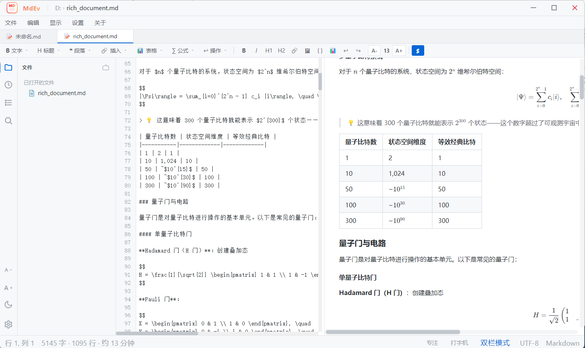
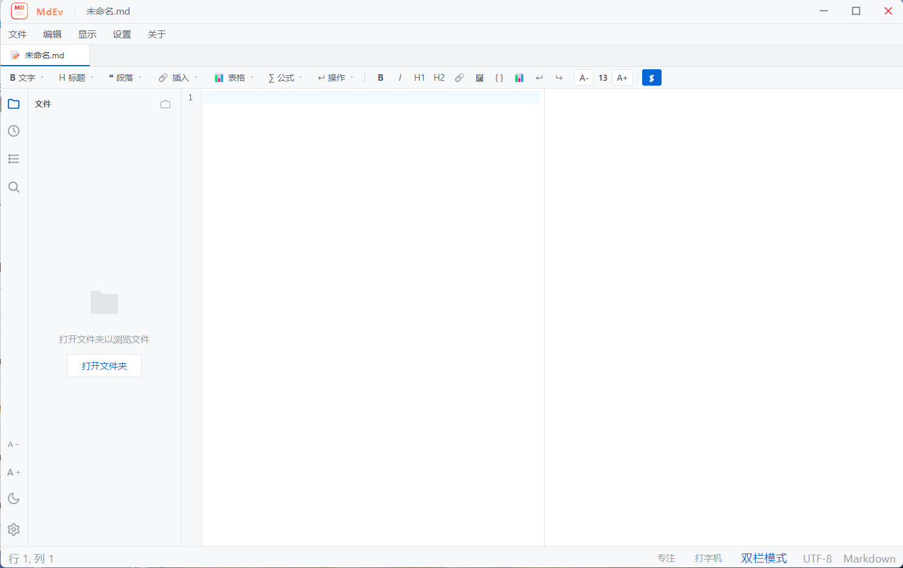

<div align="center">

# MdEv

**A lightweight, efficient local Markdown editor**

Markdown Editor for Windows — split-pane layout with editor on the left and live preview on the right. Supports project directory management, full-text search, outline navigation, math formulas, diagram rendering, theme customization, and multi-format export.

[](https://www.apache.org/licenses/LICENSE-2.0)
[](https://github.com/wrrgit/MdEv)
[](https://www.electronjs.org/)
[](https://vuejs.org/)
[](https://github.com/wrrgit/MdEv/releases)

English | [简体中文](./README.md)

</div>

---

## Introduction

MdEv is a Windows desktop Markdown editor built with Electron + Vue 3 + CodeMirror 6. It works out of the box, requires no internet connection, and performs all file operations locally — ideal for daily writing, technical documentation, and note-taking.

### Why MdEv?

- **Fully Local** — All file operations happen on your machine. Your data never leaves your computer.
- **WYSIWYG** — Left editor and right preview sync in real time with linked scrolling for a smooth writing experience.
- **Feature-Rich** — Built-in math formulas, syntax highlighting, Mermaid diagrams, PlantUML, outline navigation, and full-text search.
- **Zero Config** — Download and run. No environment setup or internet connection required.

## Screenshots






## Features

### Editor
- ✅ **CodeMirror 6 Editor** — Syntax highlighting, search & replace, bracket matching, code folding
- ✅ **Undo / Redo** — Complete edit history via toolbar buttons + shortcuts
- ✅ **Auto Save** — Debounced auto-save with real-time status indicator
- ✅ **Word Wrap** — Toggle soft wrap mode, single Enter inserts line break (Typora-style)
- ✅ **Image Drag & Drop** — Drag image files directly into the editor to insert Markdown syntax

### Preview
- ✅ **Live Preview** — markdown-it rendering + KaTeX math formulas + highlight.js code highlighting
- ✅ **Mermaid Diagrams** — Flowcharts, Gantt charts, sequence diagrams, etc.
- ✅ **PlantUML Rendering** — UML diagrams rendered via PlantUML server
- ✅ **Math Formulas** — Inline (`$...$`) + block (`$$...$$`) formulas with quick-insert templates
- ✅ **Extended Syntax** — Subscript, superscript, highlight marks, footnotes, Admonition (`::: tip` / `::: warning`)
- ✅ **Local Image Rendering** — Custom `mdimg://` protocol for displaying local relative-path images
- ✅ **Preview Click-Through** — Click local file links in preview to open with system default app

### Toolbar
- ✅ **Rich Toolbar** — 7 dropdown groups: Text / Headings / Paragraph / Insert / Table / Formula / Action
- ✅ **Quick Button Bar** — 10 one-click shortcuts (Bold / Italic / Heading / Link / Image / Code block / Table / Undo / Redo)
- ✅ **Table Operations** — Visual row/column picker, add/delete rows and columns
- ✅ **Formula Templates** — Inline / block formula templates with 6 common math expressions
- ✅ **Image Insert** — File picker + drag & drop + web image URL dialog
- ✅ **Link Insert** — Dialog for link description + URL

### Project Management
- ✅ **Project Directory** — Open a folder as a project, browse / create files and folders in the file tree
- ✅ **Multi-Tab** — Drag-to-reorder, unsaved indicators, context menu close
- ✅ **Recent Files** — Quick access to recent files / folders via sidebar and file menu submenu
- ✅ **Session Restore** — Automatically reopens last document and folder on startup
- ✅ **File Type Support** — Markdown, JSON, images (images open in system viewer)

### Navigation & Search
- ✅ **Outline Navigation** — Auto-extracted heading tree, click to jump to sections
- ✅ **Full-Text Search** — In-file search (`Ctrl+F`) + cross-file search (`Ctrl+Shift+F`)
- 📋 TOC auto-highlight current section on scroll — Planned
- 📋 Search term highlighting in preview — Planned

### Personalization
- ✅ **Theme Toggle** — Light / Dark / Follow system, one-click via sidebar sun/moon icon
- ✅ **Font Settings** — Independent editor / preview font selection, sidebar A+/A− quick font size adjustment
- ✅ **Settings Panel** — 4 sections: Appearance / Editor / Preview / Files, gear icon entry

### Export
- ✅ **Export PDF** — Formulas and styles fully preserved
- ✅ **Export HTML** — Standalone HTML file, viewable offline
- 📋 Custom PDF header/footer — Planned
- 📋 Export progress indicator — Planned

### UI
- ✅ **Brand Identity** — Title bar logo + app name "MdEv"
- ✅ **Sidebar Icons** — Lucide-style line icons, clear and recognizable
- ✅ **About Dialog** — Includes GitHub repository link

## Download & Install

### Option 1: Direct Download (Recommended)

Go to the [Releases page](https://github.com/wrrgit/MdEv/releases) and download the latest `MdEv-Setup-0.6.0.exe`, then double-click to install.

> A portable version `MdEv-Portable-0.6.0.exe` is also available — no installation required, just run it.

### Option 2: Build from Source

For developers or users who want to compile themselves.

#### Prerequisites

- Node.js ≥ 18 (20 LTS recommended)
- npm ≥ 9

#### Steps

```bash
# Clone the repository
git clone https://github.com/wrrgit/MdEv.git
cd MdEv

# Install dependencies
npm install

# Development mode (Electron + Vite HMR)
npm run electron:dev

# Build a Windows installer (NSIS)
npm run make

# Or build a portable version
npm run package
```

Build artifacts are placed in `D:\mdev-release\` (the output directory is configured outside the project).

## Keyboard Shortcuts

| Shortcut | Action |
|----------|--------|
| `Ctrl + N` | New file |
| `Ctrl + O` | Open file |
| `Ctrl + Shift + O` | Open folder |
| `Ctrl + S` | Save |
| `Ctrl + Shift + S` | Save as |
| `Ctrl + F` | Find in file |
| `Ctrl + Shift + F` | Search across files |
| `Ctrl + G` | Go to line |
| `Ctrl + B` | Toggle sidebar |
| `Ctrl + ,` | Open settings |
| `Ctrl + Z` | Undo |
| `Ctrl + Y` | Redo |
| `Ctrl + M` | Insert inline formula |
| `Ctrl + Shift + M` | Insert block formula |

## Tech Stack

| Layer | Technology |
|-------|------------|
| Desktop Shell | Electron 33 |
| UI Framework | Vue 3 (Composition API) |
| Build Tool | Vite 5 |
| State Management | Pinia |
| Code Editor | CodeMirror 6 |
| Markdown Parser | markdown-it + plugins (sub/sup/mark/footnote/container) |
| Math Formulas | KaTeX |
| Code Highlighting | highlight.js |
| Diagram Rendering | Mermaid |
| UML Rendering | PlantUML (plantuml-encoder) |
| Security Filter | DOMPurify |
| Base Styles | github-markdown-css |
| PDF Export | jsPDF + html2canvas |
| Settings Storage | electron-store |

## Project Structure

```
MdEv/
├── electron/               # Electron main process
│   ├── main.js             # Window management, IPC, custom protocol
│   └── preload.cjs         # Secure bridge (Context Isolation)
├── src/                    # Renderer process (Vue 3)
│   ├── components/         # UI components
│   │   ├── TitleBar.vue          # Custom title bar (logo + app name)
│   │   ├── MenuBar.vue           # Menu bar (with recent files submenu)
│   │   ├── TabBar.vue            # Tab bar
│   │   ├── Toolbar.vue           # Toolbar (7 groups + quick bar)
│   │   ├── FileTree.vue          # File tree
│   │   ├── EditorPane.vue        # Editor pane
│   │   ├── PreviewPane.vue       # Preview pane
│   │   ├── PanelSidebar.vue      # Sidebar (filetree/recent/toc/search + theme/font/settings)
│   │   ├── SettingsPanel.vue     # Settings panel
│   │   ├── ExportDialog.vue      # Export dialog
│   │   ├── StatusBar.vue         # Status bar
│   │   └── WelcomePage.vue       # Welcome page
│   ├── composables/       # Composition functions (export, theme)
│   ├── core/              # Markdown parsing core
│   ├── stores/            # Pinia state management
│   ├── config/            # Toolbar config
│   └── styles/            # CSS variable themes
├── build/                  # App icon resources
├── docs/                   # Project documentation
├── package.json
├── vite.config.js
└── README.md
```

## Roadmap

| Version | Goal | Status |
|---------|------|--------|
| v0.1.0 | MVP core editor + preview + basic export | ✅ Released |
| v0.2.0 | Toolbar enhancement + theme/font + recent files + image support + PlantUML | ✅ Released |
| v0.3.0 | Navigation + search experience (TOC highlight, search highlight, scroll sync, quick open) | ✅ Released |
| v0.4.0 | Export expansion (PNG export, step-by-step progress) | ✅ Released |
| v0.5.0 | Writing experience (focus/typewriter mode, clipboard paste, external change detection, file tree context menu, drafts & session restore) | ✅ Released |
| v0.6.0 | System integration & interaction (`.md` file association, selection context menu, scroll sync fix, recents persistence) | ✅ Released |
| v0.7.0 | Packaging & release enhancements (auto-update, test coverage, user manual) | 📋 Planned |
| v1.0.0 | Official release | 📋 Planned |

See [ROADMAP.md](./docs/ROADMAP.md) for details.

## Contributing

Issues and Pull Requests are welcome!

Before submitting, please ensure:

1. Follow the [Conventional Commits](https://www.conventionalcommits.org/) specification
2. Keep code style consistent with the existing codebase
3. Update relevant documentation

## License

This project is licensed under the [Apache License 2.0](./LICENSE).

Copyright © 2026 [wrrgit](https://github.com/wrrgit)

---

<div align="center">

If you find this project helpful, please consider giving it a ⭐ Star!

</div>
